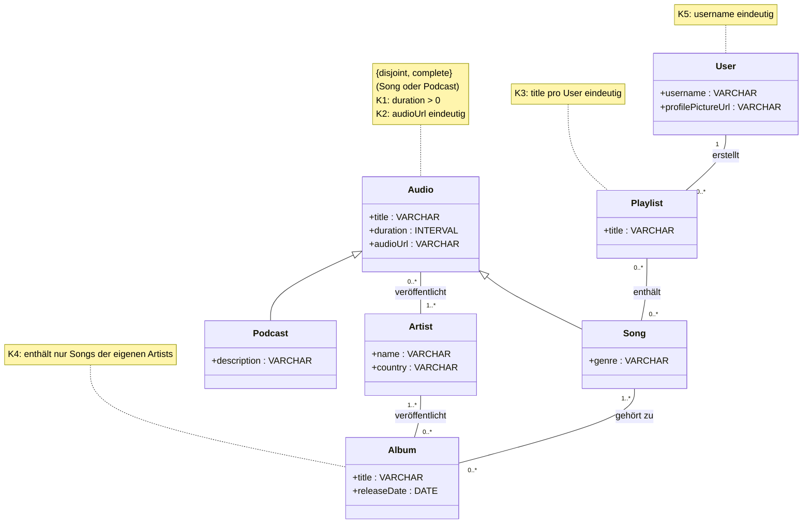

# Audioverwaltung

## Beschreibung

Die Audioverwaltung verwaltet Audioinhalte wie Songs und Podcasts. Jedes Audio hat einen Titel, eine Dauer und eine Audio-URL und ist entweder ein Song oder ein Podcast. Ein Song hat zusätzlich ein Genre, ein Podcast eine Beschreibung. Audios werden von einem oder mehreren Artists veröffentlicht, ein Artist veröffentlicht beliebig viele Audios. Songs können auf Alben erscheinen, ein Album hat ein Veröffentlichungsdatum, wird von einem oder mehreren Artists veröffentlicht und enthält mindestens einen Song. Ein Song kann auf mehreren Alben vorkommen oder auf keinem (Single). User haben einen Benutzernamen und ein Profilbild und erstellen eine oder mehrere Playlists, die Songs enthalten. Ein Song kann in beliebig vielen Playlists enthalten sein.

## Konsistenzbedingungen

1. Die Dauer eines Audios ist grösser als 0.
2. Die Audio-URL eines Audios ist eindeutig.
3. Der Titel einer Playlist ist pro User eindeutig.
4. Ein Album enthält nur Songs, die von mindestens einem Artist des Albums veröffentlicht wurden.
5. Der Benutzername eines Users ist eindeutig.

## Einsatz von KI für Abgabe #1

Beschreibung, Konsistenzbedingungen und Klassendiagramm wurde von den Autoren erstellt mit Unterstützung von Claude Code verbessert.

## Klassendiagramm




## Logisches DB-Modell

Primärschlüssel ist jeweils das erste Attribut, bei den Beziehungstabellen die Kombination der beiden Fremdschlüssel. Die Vererbung von `Audio` ist mit einer Tabelle pro Klasse umgesetzt: `Song` und `Podcast` verwenden den Schlüssel von `Audio` als Primär- und Fremdschlüssel. User wurde zu AppUser umbenannt, da User ein reserviertes Wort ist.

```
Audio (
  ID INTEGER,
  Title VARCHAR(200) NOT NULL,
  Duration INTERVAL NOT NULL,
  AudioUrl VARCHAR(500) NOT NULL UNIQUE
)
Song (
  Audio REFERENCES Audio,
  Genre VARCHAR(50)
)
Podcast (
  Audio REFERENCES Audio,
  Description VARCHAR(2000)
)
Artist (
  ID INTEGER,
  Name VARCHAR(100) NOT NULL,
  Country VARCHAR(50)
)
Album (
  ID INTEGER,
  Title VARCHAR(200) NOT NULL,
  ReleaseDate DATE NOT NULL
)
AppUser (
  ID INTEGER,
  Username VARCHAR(50) NOT NULL UNIQUE,
  ProfilePictureUrl VARCHAR(500)
)
Playlist (
  ID INTEGER,
  Title VARCHAR(100) NOT NULL,
  AppUser NOT NULL REFERENCES AppUser
)
AudioArtist (
  Audio REFERENCES Audio,
  Artist REFERENCES Artist
)
AlbumArtist (
  Album REFERENCES Album,
  Artist REFERENCES Artist
)
AlbumSong (
  Album REFERENCES Album,
  Song REFERENCES Song
)
PlaylistSong (
  Playlist REFERENCES Playlist,
  Song REFERENCES Song
)
```

## Einsatz von KI für Abgabe #2

Zur Überführung des Klassendiagramms in das DB-Modell sowie der Erstellung der SQL-Anweisungen wurde Claude verwendet. Die Outputs von Claude wurden durch uns kontrolliert, getestet und grosszügig angepasst. Als Start-Prompt wurde folgender verwendet: ` We need to add the logical model in the relational style. I've attached an example.` Dazu wurde Das Flugverwaltungsbeispiel angehängt. Die folgenden Aufgaben wurden darauf aufbauend umgesetzt: 2_schema.sql konnte ziemlich vollständig aus dem DB-Modell übernommen werden. Die Testdaten wurden unter Berücksichtigung der verschiedenen many-to-many Anwendungsfälle von Claude generiert. Ebenfalls wurden die Constraints getestet, diese Anweisungen geben wir jedoch nicht ab (da es beim Ausführen ja keine Errors geben darf).